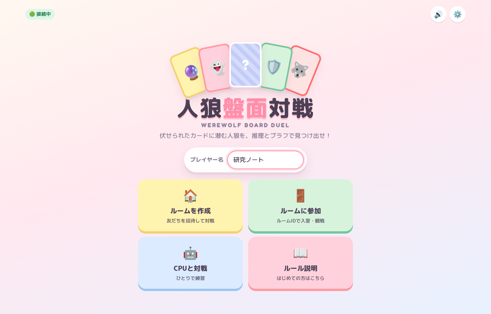
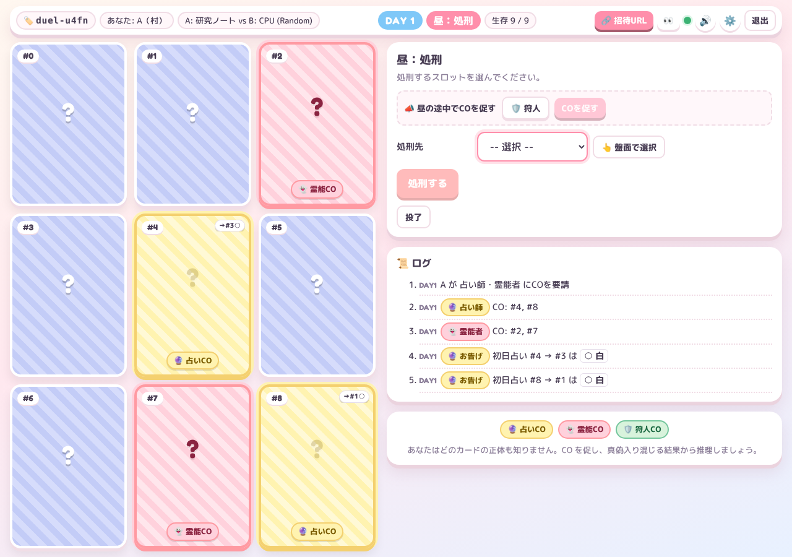

[← ゲームに戻る](index.qmd)

::: {.callout-note}
## この成果物について

人狼ゲームの **進行**（誰に CO を促し、誰を吊り、誰を占わせ、誰を守るか）を、村側と人狼側の 2 人が対戦するカードゲームにした Web アプリです。ブラウザだけで遊べます。

**[▶ 人狼盤面対戦を開く](https://werewolf-board-duel.onrender.com/)**

- **起動待ち**：無料のサーバーで動いているため、しばらく誰も使っていないと停止しています。最初のアクセスでは、起動まで数十秒〜1 分ほどかかることがあります。
- **ソースコード**：現在は公開していません。
- **画面の画像について**：このページの画像は **ver1.0** の画面です。機能の追加とともに画面の見た目は変わっていくため、現在の画面とは異なる場合があります。ルールの細部も、今後の更新で変わることがあります。
:::

{fig-alt="人狼盤面対戦のタイトル画面" width=85%}

## 概要

人狼ゲームの勝敗は、議論の上手さだけでは決まりません。どの役職に名乗り出を促し、どの順で吊り、占い師や狩人にどう指示するかという **進行の判断** が、大きく効いてきます。

人狼盤面対戦は、この進行の判断だけを取り出したゲームです。議論は行いません。盤面に伏せられたカードの正体をめぐって、次の 2 人が対戦します。

- **A（村人陣営）**：どのカードの正体も知りません。名乗り出の要請、処刑、占い先の指定、護衛の指示を通して、人狼を探します。
- **B（人狼陣営）**：人狼の位置を知っています。人狼にどの役職を騙らせるか、どんな偽の結果を出すか、誰を襲撃するかを決めて、A を欺きます。

本物の役職と騙りは、同じ形式で区別なく公開されます。A は、食い違う結果のどれが本物かを推理しなければなりません。

このサイトの[研究課題](../about.qmd#研究課題)の一つは、10A狩・12A猫の初日の CO 戦略のナッシュ均衡を求めることです。本アプリは、その **進行のゲームを、人が実際に遊べる形にした** ものです。同時に、ゲームのルールを計算機で扱える形に書き下したものでもあります（§4）。

# 1 盤面

{fig-alt="カードが3×3に並んだ対戦画面。占いCOと霊能COのカードが色分けされ、右側に操作パネルとログがある" width=100%}

- **カード**：盤面には、プレイヤーを表すカードが伏せて並びます。名乗り出たカードは役職の色に変わり、占い結果がカードの右上に付きます。
- **操作パネル**：右上のパネルで、その場面でできる操作を選びます。
- **ログ**：その下のログに、公開された情報が順に記録されます。

# 2 ルールの要点

## 2.1 情報の非対称

| | A（村人陣営） | B（人狼陣営） |
|---|---|---|
| 知っていること | 公開情報のみ（観戦者と同じ） | 人狼の位置のみ。狂人の位置は知らない |
| 主な操作 | CO の要請、処刑、占い先の指定、護衛の指示 | 配置、騙りの作戦、偽の結果、襲撃先 |

: {tbl-colwidths="[20,40,40]"}

嘘をつけるのは人狼と狂人だけで、村人陣営のカードは本物の役職でしか名乗り出ません。

## 2.2 1 日の流れ

1. **開始前（B）**：人狼の配置（ランダムか手動か）と、騙りの作戦を決めます。人狼・狂人それぞれに、占い師を騙る、霊能者を騙る、潜伏する、のいずれかを割り当てます。
2. **CO 要請（A）**：占い師・霊能者・狩人などに名乗り出を求めます。
   - 本物と、作戦どおりの騙りが、区別なく同時に名乗り出ます。
   - 「黒を引いた占い師だけ先に名乗り出させる」という要請もできます。
3. **処刑（A）**：吊るカードを 1 枚選びます。
4. **夜（A と B）**：
   - A：占い師 CO 者の占い先を指定し、狩人 CO 者に護衛を指示します。
   - B：襲撃先と偽の結果を決めます。
5. **朝**：護衛の判定のあと、本物と偽物の結果が同じ形式で公開されます。

生存している人狼が 0 なら村の勝ち、人狼の数が人間の数以上になれば人狼の勝ちです。

## 2.3 配役

| 配役 | 内容 |
|---|---|
| スタンダード 9 人 | 村 3・狼 2・占・霊・狂・狩（欠けなし） |
| 10A狩 | 村 4・狼 2・占・霊・狂・狩（初日犠牲者あり） |
| 12A猫 | 村 4・狼 3・占・霊・狂・狩・猫又（初日犠牲者あり） |
| 12B | 村 5・狼 2・占・霊・狂・狩・妖狐（初日犠牲者あり） |
| 17A | 村 7・狼 3・占・霊・狂・狩・共有 2・妖狐（初日犠牲者あり） |

: {tbl-colwidths="[25,75]"}

「初日犠牲者あり」の配役では、開始前に 1 枚が盤面から除かれます。そのため、占い師や狩人が最初から欠けていることがあります。何が欠けたかは、決着まで A にも B にも分かりません。

## 2.4 実際の人狼の定石を反映した仕組み

- **遅れて名乗り出る**：
  - 2 日目以降に名乗り出た本物の霊能者は、それまでの処刑者全員の結果を一度に公開します。
  - 遅れて名乗り出る騙りの場合は、B がその場で過去の結果を作ります。
- **潜伏している狩人**：
  - 名乗り出ていない本物の狩人は、A から指示を受けられません。
  - そのため、確定した占い師（占い師 CO が 1 人だけのとき）、次に確定した霊能者、という優先順位で自動的に護衛します。
- **ギドラ（12A猫）**：狩人と猫又を「どちらか」として同時に名乗り出させ、あとで役職を明かす要請です。
- **妖狐（12B・17A）**：システムが操作する第三陣営です。本物の占い師に占われると呪殺され、村か人狼の勝利条件を満たした時点で生き残っていれば単独で勝ちます。

# 3 遊び方

- **友人と対戦する**：
  1. 「ルームを作成」で陣営と配役を選び、招待 URL を相手に送ります。
  2. 相手が名前を入れると、すぐに対局が始まります。
  - 観戦用の URL もあります。
  - 回線が切れても、自動で再接続して盤面が復元されます。
- **ひとりで練習する**：「CPU と対戦」を選ぶと、ランダムに行動する CPU を相手に遊べます。
- **見た目と音**：
  - カードのテーマを 4 種類から選べます。
  - BGM と効果音は、ブラウザ内でその場で合成しています（音声ファイルは使っていません）。

# 4 研究との関係

このゲームは、遊ぶためだけでなく、**進行の最適戦略を計算するための土台** として設計しています。

- **ゲームの中身と画面を分けている**：
  - ルールの処理（合法手の列挙・状態遷移・勝敗判定・偶然の要素）は、通信や画面から完全に独立した部分として作りました。
  - そのため、CFR（反実仮想後悔最小化）や IS-MCTS（情報集合モンテカルロ木探索）といった、不完全情報ゲームの探索・学習の手法にそのまま組み込めます。
  - 各プレイヤーに見えている情報（情報集合）を一意に表すキーも用意しています。
- **情報漏れを防ぐ**：
  - 画面にもエージェントにも、ゲームの完全な状態は渡しません。必ず「そのプレイヤーから見えるもの」だけを作る 1 つの関数を通します。
  - 自動テストでは、「そのプレイヤーには区別できないはずの隠れ情報を入れ替えても、見える情報が完全に一致する」ことを確かめています。
  - これは、[自己対戦による人狼AI](../research/self-play-ai.qmd) で問題になった情報リーク（§5）を、設計の段階で防ぐための仕組みです。
- **ルールを厳密に書き下す**：
  - 1 つのルール（たとえば潜伏狩人の自動護衛）を決めるたびに、その処理をテストに書き起こしました。
  - 自動テストは約 200 件あります。

このエンジンは、**10A狩・12A猫の初日の CO 戦略** について、村側と人狼側がともに最善を尽くしたときの均衡を計算することを想定して作っています。均衡の計算そのものは、まだ行っていません。

::: {.callout-warning appearance="simple"}
## 運用上の注意

- **対局の保存**：対局はサーバーのメモリ上にだけ保存されます。サーバーが再起動すると、進行中の対局は消えます。
- **CPU の強さ**：CPU は現在、合法手からランダムに選ぶだけです。強い CPU は、上記の均衡の計算とあわせて今後の課題です。
:::
