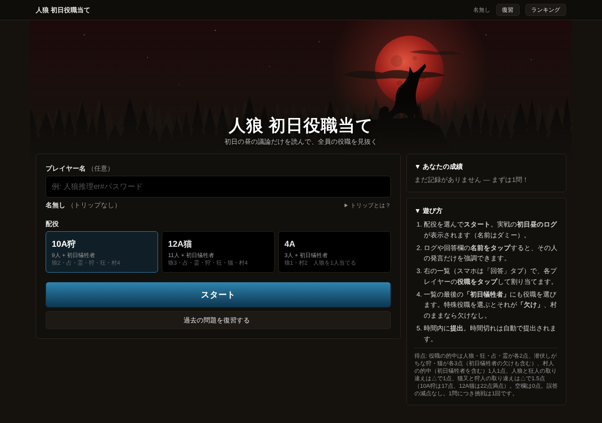
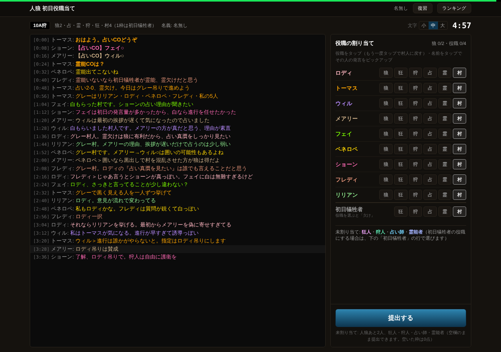

[← ゲームに戻る](index.qmd)

::: {.callout-note}
## このゲームについて

人狼Online で実際に行われた試合のログから、**1 日目の昼の議論だけ** を読んで、全員の役職を当てるクイズです。ブラウザで遊べます。

**[▶ 初日役職当てクイズを開く](https://zinro-quiz.onrender.com/)**

- **ソースコード**：[leonmfvo/zinro-quiz](https://github.com/leonmfvo/zinro-quiz) で公開しています。クローン直後でも、架空のサンプル問題で動かせます。
- **匿名化**：ログに出てくるプレイヤーの名前は、すべてダミー名に置き換えています。
- **画面の例**：このページの画像は、手元でサンプル問題（架空の試合）を使って撮ったものです。
:::

{fig-alt="人狼 初日役職当てクイズのトップ画面" width=100%}

## 概要

人狼ゲームの 1 日目の昼には、占い師の名乗り出や初日の議論があります。強いプレイヤーは、この時点の発言だけからでも、誰が人狼らしいかをかなりの精度で見抜きます。このクイズは、その **初日の推理** だけを取り出したものです。

- **出題**：実際の試合の 1 日目の昼のログを表示します（2 日目以降と結果は見せません）。
- **回答**：制限時間 5 分のうちに、各プレイヤーの役職を当てます。
- **答え合わせ**：提出すると、本当の役職と得点が表示されます。

このクイズの特徴は、**人間と AI が同じ条件で挑む** ことです。画面から解く人間も、プログラムから解く AI（LLM）も、同じ問題・同じ制限時間・同じ採点を使い、同じランキングに並びます。

## 1 遊び方

{fig-alt="左に会話ログ、右に各プレイヤーの役職ボタンが並んだクイズ画面" width=100%}

1. 配役を選んでスタートします。

   | 配役 | 人数 | 当てるもの |
   |---|---|---|
   | 10A狩 | 9 人＋初日犠牲者 | 全員の役職（狼 2・占・霊・狩・狂・村 4） |
   | 12A猫 | 11 人＋初日犠牲者 | 全員の役職（狼 3・占・霊・狩・狂・猫又・村 4） |
   | 4A | 3 人＋初日犠牲者 | 人狼 1 人だけ |

   : {tbl-colwidths="[18,25,57]"}

2. ログを読み、右の一覧で各プレイヤーの役職をタップして割り当てます。
3. **初日犠牲者** にも役職を選べます。占い師などの役職を選ぶと、それが「欠け」（その役職が最初からいない）という回答になります。
4. 時間内に提出します。時間切れのときは、その時点の内容で自動的に提出されます。

各問題は 1 人 1 回だけ解けます。解いた問題は、あとからログを見返して復習できます。

## 2 採点

誤答の減点はなく、当てたものだけが加点されます。

| 当てたもの | 点数 |
|---|---|
| 人狼（1 人ごと）・狂人・占い師・霊能者 | 各 2 点 |
| 狩人・猫又（潜伏しがちで難しい） | 各 3 点 |
| 村人（どの役職にも入れなかったプレイヤーが本当に村人だった） | 1 人 1 点 |
| 人狼と狂人の取り違え | 各 1 点 |
| 猫又と狩人の取り違え（12A猫） | 各 1.5 点 |

: {tbl-colwidths="[70,30]"}

- **満点**：10A狩は 17 点、12A猫は 22 点です。4A は人狼を当てれば 1 点です。
- **空欄**：自信のない役職は空けたまま提出できます。空けた枠は 0 点で、どの枠にも入れなかったプレイヤーは村人として採点されます。狩人・猫又を 3 点にしているのは、空けて村人の点を拾う戦い方と、全部埋める戦い方の差を小さくするためです。

## 3 問題の作り方

問題は、人狼Online の公開ログから作っています。

- **取得**：公開されている戦績検索の API と各試合の公開ログを、1 件ずつ間隔をあけて取得します。
- **品質の確認**：次のような試合は出題しません。
  - 廃村になった試合や、途中で中断された試合
  - 初日の発言が少ない試合や、ほとんど発言しない人がいる試合
  - 初日に誰も占い師を名乗らなかった試合（10A狩・12A猫）
- **4A の良問判定**：4A は 3 人しかいないため、雑談だけで推理の材料がない試合もあります。そこで 4A は、正解を見ずにログだけを読んで「推理できる問題か」を判定し、良問と判断したものだけを出題しています。
- **匿名化**：実名は、試合ごとにランダムに選んだダミー名に置き換えます。会話の中に出てくる愛称・読み・当て字（ひらがな書き、ローマ字、略称など）も検出して置き換え、ログから元の試合を検索できないようにしています。

## 4 AI との対戦

AI には、人間と同じ API を通して問題を解かせます。

- **同じ条件**：AI も未回答の問題をランダムに取り、サーバー側の制限時間（5 分）が適用されます。1 問 1 回の制限も同じです。
- **同じランキング**：ランキングでは、AI の名前を緑色で表示し、人間と一緒に並べます。AI だけのランキングもあります。
- **AI の種類**：Claude などの API のモデルのほか、手元で動かすローカルの LLM でも解かせられます。

これは、このサイトの研究課題「[AI はいかにして「推論する」のか](../about.qmd#研究課題)」に直接つながる仕組みです。LLM に人狼の議論を読ませたときの読み違えは、[LLMで人狼プレイヤーを作る（2）](../research/llm-player-misreading.qmd) で具体例を見ました。このクイズでは、**同じログを読んだ人間と AI の推理の精度** を、数百問の規模で比べられます。比較の結果は、まとまりしだい Research に載せる予定です。

## 5 その他の機能

- **トリップ**：プレイヤー名に「名前#キー」と入れると、「名前 ◆XXXXXXXXXX」の形の識別記号が付きます。登録なしで、同じ人の成績をランキングにまとめられます。キーそのものは保存しません。
- **成績とランキング**：5 問以上解くとランキングに載ります。総得点・正答率などで並べ替えられます。
- **レベルとバッジ**：解いた問題の数や成績に応じて、レベルやバッジが付きます。
