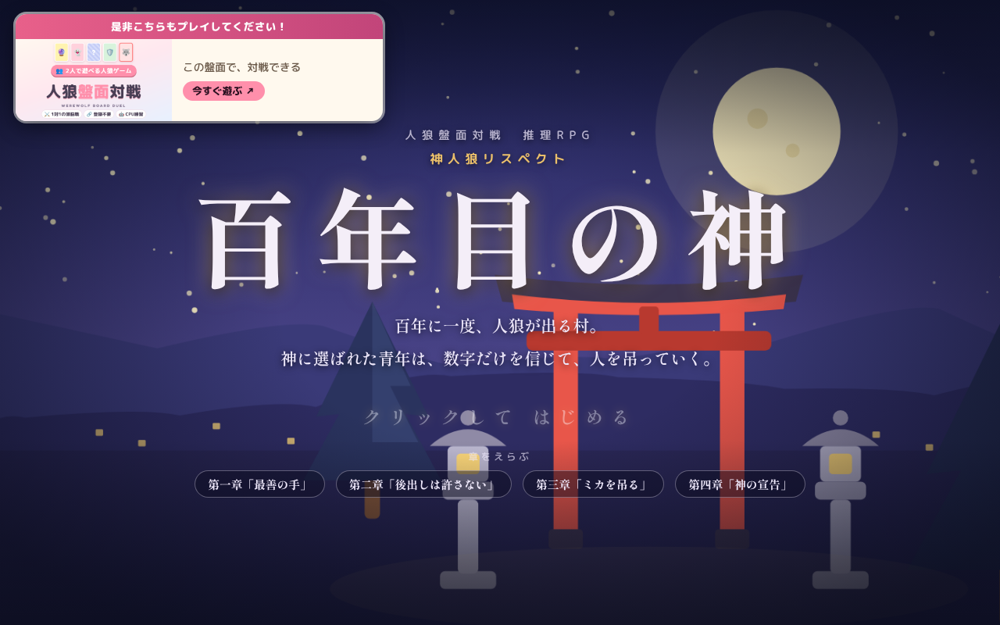
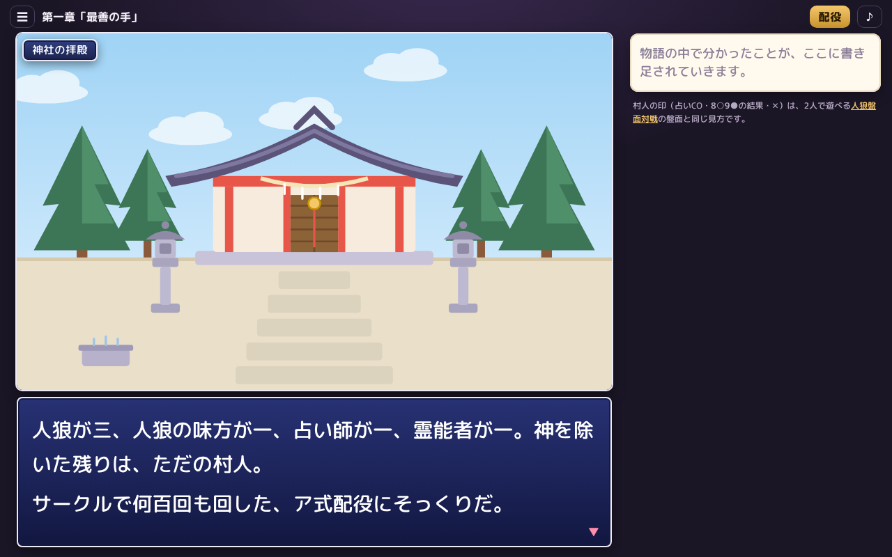

[← ゲームに戻る](index.qmd)

::: {.callout-note}
## このゲームについて

[人狼盤面対戦](board-duel.qmd) のサイトで公開している、ブラウザで遊べる推理RPGです。登録なしで、そのまま遊べます。

**[▶ 百年目の神を開く](https://jinro-duel.com/rpg)**

- **ネタバレについて**：このページでは、物語の真相や結末の内容には触れません。
- **画像について**：このページの画像は 2026/11/23 時点の画面です。更新とともに見た目が変わることがあります。
- **ソースコード**：人狼盤面対戦と同じく、現在は公開していません。
:::

{fig-alt="推理RPG「百年目の神」のタイトル画面。月と鳥居の夜景に題字がある" width=100%}

## 概要

> 百年に一度、人狼が出る村。
> 神に選ばれた青年は、数字だけを信じて、人を吊っていく。

数学を学ぶ大学生のカイは、百年に一度の祭りに合わせて山あいの村へ帰郷し、村でただ一人、処刑する人を決める「**神**」に選ばれます。プレイヤーはカイとして、名乗り出た占い師や霊能者の結果を読み、毎日だれを吊るかを決めていきます。

タイトルに「神人狼リスペクト」と掲げた作品です。

# 1 遊び方

{fig-alt="神社の拝殿の背景に、配役について話す文章が表示されたゲーム画面" width=100%}

- **物語を読む**：画面をクリック（タップ）すると、文章が進みます。
- **メモを見る**：右側のメモに、名乗り出や占い結果など、物語の中で分かったことが書き足されていきます。占い師の名乗り出や白黒の結果は、[人狼盤面対戦](board-duel.qmd) の盤面と同じ記号で表示されます。
- **配役を確かめる**：右上の「配役」で、村の役職の構成をいつでも見られます。
- **クイズに答える**：物語の要所で、「いま誰が人狼と言えるか」「誰を吊るべきか」といった推理のクイズが出ます。全部で 8 問あり、答えると解説が表示されます。
- **選ぶ**：処刑先や、夜に守る人を自分で選ぶ場面もあります。

# 2 村のルール

物語の村は、普通の人狼とは少し違うルールで動いています（序章の最後に画面にも表示されます）。

- 12 人の村で、そのうち 1 人が「神」です。残りの 11 人の中に、人狼 3・狂人 1・占い師 1・霊能者 1・村人 5 がいます。狩人はいません。
- 神は、生きている人数に数えません。占い・襲撃・処刑の対象にもなりません。
- 神は、毎日ひとりで処刑する人を決めます（処刑なしは選べません）。
- 夜、神が守りたい 1 人を強く念じると、その人は人狼に襲われません（神の加護）。

# 3 構成

| 章 | 題 |
|---|---|
| 第一章 | 最善の手 |
| 第二章 | 後出しは許さない |
| 第三章 | ミカを吊る |
| 第四章 | 神の宣告 |

: {tbl-colwidths="[25,75]"}

- **結末**：クイズの正誤や途中の選択によって、物語の結末が分かれます。条件を満たすと現れる隠れた結末もあります。
- **章選び**：タイトル画面から、遊びたい章を選んで始められます。

# 4 研究との関係

このゲームは、人狼の **進行** を物語の形で体験できるようにしたものです。

- **主人公は「進行役」**：主人公は、だれを吊り、だれを守るかを一人で決める立場にいます。これは、[人狼盤面対戦](board-duel.qmd) で村人陣営のプレイヤーが担う進行の判断と同じ役割です。
- **推理がそのままクイズになる**：名乗り出・占い結果・霊能結果・人数の数え方といった人狼の論理を、物語の中のクイズとして解いていきます。人狼を遊ぶ人は矛盾にすぐ気づくため、人狼の論理に関わる部分（占い結果・名乗り出・推理の理由・人数の数え方）は、作者が人狼側の視点も含めて確認しています。
- **台本からゲームを作る**：物語の文章・クイズ・選択肢は 1 つの台本ファイルに書き、それを変換してゲームのデータを作っています。変換と分岐は自動テストで確かめています。

人狼盤面対戦の研究としての中身（ゲームの定式化・推論する CPU・厳密ソルバー）は、研究ノート「[人狼盤面対戦：進行を 2 人の不完全情報ゲームとして実装する](../research/board-duel-research.qmd)」にまとめています。
